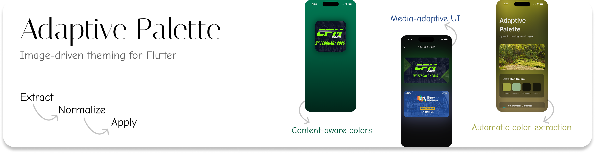

# Adaptive Palette

[](https://pub.dev/packages/adaptive_palette)
[](https://github.com/HardikSJain/adaptive_palette/actions)
[](https://opensource.org/licenses/MIT)
[](https://flutter.dev)

<p align="center">
    
</p>

**Immersive fluid animated backgrounds from images with intelligent color extraction.**

Create stunning, music app-style backgrounds that adapt to your images with smooth animations and vibrant colors.

## Features

✨ **Fluid Animated Backgrounds** - Layered image shaders with orbital motion and heavy blur
🎨 **Intelligent Color Extraction** - Weighted k-means clustering for accurate palette generation
🌊 **Smooth Transitions** - Cross-fade between images with palette color tweening
💫 **Corner Accent Glows** - Radial gradients using extracted colors
🎭 **Matte Treatment** - Prevents harsh whites, ensures rich vibrant colors
⚡ **Performance Optimized** - Instant fallback, cached extraction, isolated repaints
♿ **Respects Reduced Motion** - The orbit pauses when the platform asks for less motion
🌐 **Runs Everywhere** - Android, iOS, web (including WebAssembly), macOS, Windows, Linux

## Installation

```yaml
dependencies:
  adaptive_palette: ^3.2.0
```

## Quick Start

### Option 1: FluidBackground Widget (Recommended)

The easiest way - widget handles everything automatically:

```dart
import 'package:adaptive_palette/adaptive_palette.dart';
import 'package:flutter/material.dart';

class MusicPlayer extends StatelessWidget {
  @override
  Widget build(BuildContext context) {
    return FluidBackground(
      imageProvider: NetworkImage('https://example.com/album.jpg'),
      child: Scaffold(
        backgroundColor: Colors.transparent,
        appBar: AppBar(
          backgroundColor: Colors.transparent,
          elevation: 0,
          title: Text('Now Playing'),
        ),
        body: YourContent(),
      ),
    );
  }
}
```

### Option 2: Extract Dominant Colors

Extract the top N dominant colors directly from any `ImageProvider` — no
intermediate `ui.Image` handling required:

```dart
import 'package:adaptive_palette/adaptive_palette.dart';

final colors = await FluidPaletteExtractor.extractColors(
  NetworkImage('https://example.com/album.jpg'),
  count: 5, // 1–10, default 5
);

// colors[0] is most dominant, use however you like
Container(color: colors[0]);
GradientBackground(colors: colors);
```

Results are cached by image content, so repeated calls with the same image
skip the clustering step.

#### Pre-warming the cache

For music players or galleries, pre-warm upcoming images to eliminate first-
display latency:

```dart
await FluidPaletteExtractor.warmup([
  NetworkImage(nextTrack.albumArtUrl),
  NetworkImage(upNextTrack.albumArtUrl),
]);
```

## FluidBackground Widget

### Basic Usage

```dart
FluidBackground(
  imageProvider: NetworkImage(albumUrl),
  child: YourContent(),
)
```

### Full Configuration

```dart
FluidBackground(
  // Optional - shows matte fallback if null
  imageProvider: imageUrl == null ? null : NetworkImage(imageUrl),

  // Blur intensity (60-120 recommended)
  blurSigma: 80,

  // Dark overlay for text legibility (0.05-0.20 recommended)
  overlayDarken: 0.10,

  // Enable slow orbital motion (off by default — battery friendly).
  // Pauses automatically when the platform requests reduced motion.
  animate: true,

  // Fallback palette when no image is set (dark / light / auto)
  fallbackMode: FluidFallbackMode.auto,

  // Transition duration for palette changes
  transitionDuration: Duration(milliseconds: 1400),

  // Keep the previous image on screen and crossfade to the new one
  // (off by default — cuts to the matte fallback while loading)
  smoothTransitions: true,

  child: YourContent(),
)
```

### Parameters

| Parameter | Type | Default | Description |
|-----------|------|---------|-------------|
| `imageProvider` | `ImageProvider?` | `null` | Optional image to extract colors from |
| `child` | `Widget` | required | Content to display on top |
| `blurSigma` | `double` | `80` | Blur intensity (higher = softer) |
| `overlayDarken` | `double` | `0.10` | Overlay opacity for text legibility |
| `animate` | `bool` | `false` | Enable orbital motion animation (battery-friendly default). Runs only while an image is showing and pauses when the platform requests reduced motion |
| `fallbackMode` | `FluidFallbackMode` | `auto` | Fallback palette when no image: `dark`, `light`, or `auto` (matches the Material theme brightness, or the platform brightness when there is no Material theme) |
| `transitionDuration` | `Duration` | `1400ms` | Duration of the reveal and of crossfades |
| `smoothTransitions` | `bool` | `false` | Keep the current image and palette visible while a new image loads, then crossfade to it instead of cutting to the matte fallback. Setting the image to `null` fades out, and a failed load keeps the current background |

### Smooth transitions

By default, changing `imageProvider` cuts to the matte fallback and fades the
new image in once it has loaded. With `smoothTransitions: true` the current
background stays up until the new image is ready and then crossfades to it:

```dart
FluidBackground(
  imageProvider: NetworkImage(track.albumArtUrl),
  smoothTransitions: true,
  child: YourContent(),
)
```

A crossfade that is already running always finishes before the next one
starts, so an image that loads mid-transition appears up to one
`transitionDuration` later. Skipping quickly through several images collapses
into a single crossfade to the latest one.

## FluidPalette Model

```dart
class FluidPalette {
  final Color baseDark;   // Dark base (lightness ≤ 0.22)
  final Color accent1;    // Top-left glow
  final Color accent2;    // Top-right glow
  final Color accent3;    // Bottom-left glow
  final Color accent4;    // Bottom-right glow
}
```

### Methods

```dart
// Fallback palette
FluidPalette.fallback()

// Interpolate between palettes
FluidPalette.lerp(paletteA, paletteB, 0.5)

// Copy with changes
palette.copyWith(accent1: newColor)
```

## Complete Example

```dart
import 'package:adaptive_palette/adaptive_palette.dart';
import 'package:flutter/material.dart';

void main() => runApp(MyApp());

class MyApp extends StatelessWidget {
  @override
  Widget build(BuildContext context) {
    return MaterialApp(
      title: 'Music Player',
      theme: ThemeData.dark(),
      home: MusicPlayerPage(),
    );
  }
}

class MusicPlayerPage extends StatefulWidget {
  @override
  State<MusicPlayerPage> createState() => _MusicPlayerPageState();
}

class _MusicPlayerPageState extends State<MusicPlayerPage> {
  int currentIndex = 0;

  final albums = [
    'https://picsum.photos/seed/album1/800/800',
    'https://picsum.photos/seed/album2/800/800',
    'https://picsum.photos/seed/album3/800/800',
  ];

  void nextSong() => setState(() =>
    currentIndex = (currentIndex + 1) % albums.length
  );

  @override
  Widget build(BuildContext context) {
    return FluidBackground(
      imageProvider: NetworkImage(albums[currentIndex]),
      child: Scaffold(
        backgroundColor: Colors.transparent,
        appBar: AppBar(
          backgroundColor: Colors.transparent,
          elevation: 0,
          title: Text('Now Playing'),
        ),
        body: Center(
          child: Column(
            mainAxisAlignment: MainAxisAlignment.center,
            children: [
              ClipRRect(
                borderRadius: BorderRadius.circular(16),
                child: Image.network(
                  albums[currentIndex],
                  width: 300,
                  height: 300,
                ),
              ),
              SizedBox(height: 32),
              Text('Song Title', style: TextStyle(fontSize: 28)),
              SizedBox(height: 8),
              Text('Artist Name', style: TextStyle(fontSize: 18)),
              SizedBox(height: 32),
              IconButton(
                icon: Icon(Icons.skip_next),
                iconSize: 48,
                onPressed: nextSong,
              ),
            ],
          ),
        ),
      ),
    );
  }
}
```

## How It Works

The FluidBackground widget creates immersive backgrounds through these steps:

1. **Instant Display** - Shows matte gradient fallback immediately
2. **Background Extraction** - Loads image and extracts FluidPalette
3. **Smooth Reveal** - Cross-fades from fallback to extracted colors (1400ms)
4. **Fluid Shaders** - Renders 4 layered ImageShaders with transforms:
   - Layer 1: scale 1.35, rotation -0.08→0.10, opacity 0.55
   - Layer 2: scale 0.95, rotation 0.12→-0.06, opacity 0.45
   - Layer 3: scale 0.70, rotation -0.18→0.04, opacity 0.35
   - Layer 4: scale 1.85, rotation 0.05→-0.12, opacity 0.25
5. **Heavy Blur** - Applies 80σ Gaussian blur for atmospheric effect
6. **Corner Glows** - Adds 4 radial gradients (360×360px, 90σ blur)
7. **Dark Overlay** - Subtle dark layer ensures white text legibility

## Color Extraction Algorithm

FluidPaletteExtractor uses advanced color science:

1. **Smart Sampling** - Samples every 10th pixel, filters extremes
2. **Vibrancy Weighting** - Weights by `(saturation × 0.75 + lightness × 0.25)`
3. **Center Proximity** - Increases weight for pixels near center
4. **Weighted K-Means** - Clusters into 6 centers (10 iterations)
5. **Perceptual Scoring** - Ranks by `(vivid × 1.2 + mid-tone × 0.8)`
6. **Matte Treatment** - Blends near-whites with gray (14% mix)
7. **Brightness Clamping** - Limits lightness to 0.78 max
8. **Dark Base Enforcement** - Ensures base ≤ 0.22 lightness

## Use Cases

Perfect for:
- 🎵 Music player screens
- 🎬 Video player backgrounds
- 🖼️ Gallery detail pages
- 📱 App hero screens
- 🎨 Media browsing UIs
- ✨ Immersive experiences

## Tips & Best Practices

### Visual Quality

- **Blur intensity**: 60-80 for subtle, 90-120 for dramatic
- **Overlay darkness**: 0.05-0.10 for vibrant, 0.15-0.20 for dramatic
- **Animation**: Disable (`animate: false`) for battery savings
- **Transition speed**: 1000-1500ms feels smooth

### Performance

- **Fast startup**: The matte fallback shows on the first frame
- **Cheap extraction**: One pixel in a hundred is sampled, and results are
  cached by image content (30 entries, LRU). Pre-warm with
  `FluidPaletteExtractor.warmup` to skip the work on first display
- **Isolated repaints**: The background paints in its own layer. Its
  animation does not repaint your content, and your content's repaints (a
  progress bar, say) do not repaint the background
- **No idle work**: The orbit only schedules frames while an image is showing
- **Memory**: Images are released as soon as they are no longer shown

### Image caching

`FluidBackground` accepts any `ImageProvider`. Flutter's `NetworkImage` caches
in memory only; to cache on disk, pass a provider from a caching package such
as `CachedNetworkImageProvider` from
[cached_network_image](https://pub.dev/packages/cached_network_image).

### Accessibility

When the platform asks for reduced motion (`MediaQuery.disableAnimations`),
the orbit stays still even with `animate: true`, and transitions become
near-instant.

### Common Patterns

**No image available:**
```dart
FluidBackground(
  imageProvider: null,  // Shows matte fallback only
  child: YourContent(),
)
```

**Conditional image:**
```dart
FluidBackground(
  imageProvider: imageUrl == null ? null : NetworkImage(imageUrl),
  child: YourContent(),
)
```

**Disable animation:**
```dart
FluidBackground(
  imageProvider: NetworkImage(url),
  animate: false,  // Save battery
  child: YourContent(),
)
```

## Examples

Check out the [example](example/) directory for complete, runnable examples:

- **[main.dart](example/lib/main.dart)** - Full music player with playlist,
  with switches for the orbit and smooth transitions

Run the example:
```bash
cd example
flutter run
```

## Requirements

- Flutter 3.27 or newer (Dart 3.6 or newer)
- Tested on Flutter 3.27, the current stable release and the current beta
- All Flutter platforms, including web compiled to WebAssembly
- No plugins and no native code: the only dependencies are `crypto` and
  `material_color_utilities`

### Apps built on `material_ui`

Flutter 3.47 moved Material into the separate
[material_ui](https://pub.dev/packages/material_ui) package. This package
still builds on the Material library bundled with the SDK, so that it keeps
working on Flutter releases older than 3.47. It works in `material_ui` apps
as it is, with one thing to know: a theme from `material_ui` is not visible
to it, so `FluidFallbackMode.auto` follows the platform brightness there.
To follow your app theme instead, either wrap the app in
`MaterialUiCompatibilityBridge` (from `material_ui`) or pass the mode
yourself:

```dart
FluidBackground(
  fallbackMode: Theme.of(context).brightness == Brightness.dark
      ? FluidFallbackMode.dark
      : FluidFallbackMode.light,
  child: YourContent(),
)
```

## Migration from v2.x

Version 3.0 deprecates old APIs in favor of FluidBackground. All v2.x code continues to work but shows deprecation warnings.

### Old (v2.x)

```dart
// Old Material Design theming API
final colors = await AdaptivePalette.fromImage(NetworkImage(url));
MaterialApp(theme: colors.toThemeData());
```

### New (v3.0)

```dart
// New FluidBackground widget
FluidBackground(
  imageProvider: NetworkImage(url),
  child: Scaffold(
    backgroundColor: Colors.transparent,
    body: YourContent(),
  ),
)

// Or manual extraction
final colors = await FluidPaletteExtractor.extractColors(NetworkImage(url));
```

Old widgets will be removed in v4.0.0:
- ❌ `AdaptivePalette` → ✅ `FluidPaletteExtractor`
- ❌ `PaletteScope` → ✅ `FluidBackground`
- ❌ `AdaptiveImageOverlay` → ✅ `FluidBackground`
- ❌ `AdaptiveGlowFrame` → ✅ `FluidBackground`
- ❌ `AdaptiveGradientScaffold` → ✅ `FluidBackground`

## Troubleshooting

### Colors look washed out
- Reduce `overlayDarken` (try 0.05)
- Check source image quality

### Background is too bright for white text
- Increase `overlayDarken` (try 0.15-0.20)

### Animation is choppy
- Reduce `blurSigma` (try 60)
- Disable animation: `animate: false`

### The background does not move
- `animate` is `false` by default
- The orbit pauses while the platform's reduced-motion setting is on

### Image doesn't load
- Check network connectivity
- Verify image URL
- FluidBackground will show fallback automatically

## License

MIT License - see [LICENSE](LICENSE) file for details.

## Contributing

Contributions are welcome! Please feel free to submit a Pull Request.

## Credits

Created by [Hardik Jain](https://github.com/HardikSJain)

Built with advanced color extraction using weighted k-means clustering, perceptual scoring, and fluid shader layers.
